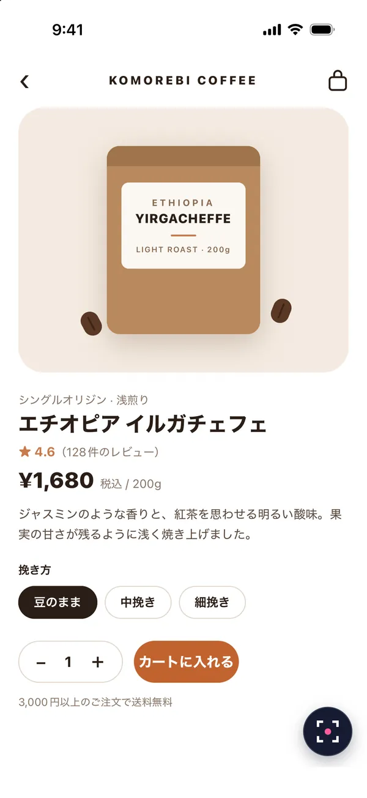
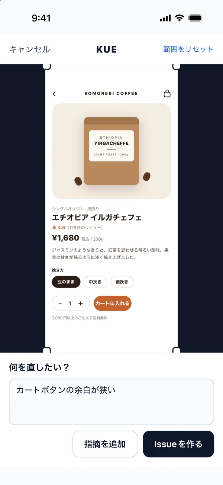
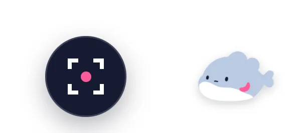
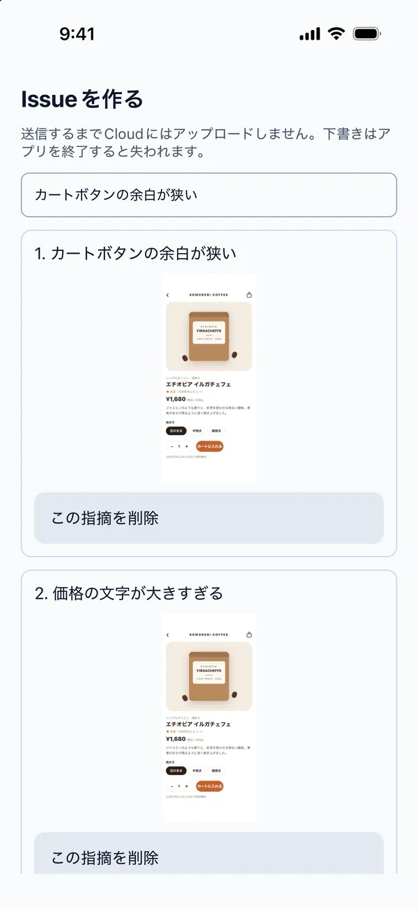
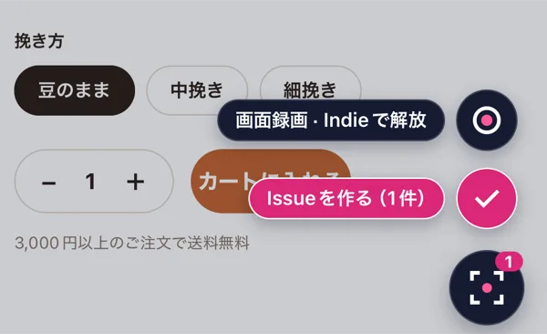

# KUE ドキュメント

KUEはExpo、ネイティブiOS／Android、Flutter、Expoを使用しないReact Nativeアプリに画面キャプチャ、範囲選択、メモ入力を組み込むSDKです。レポートの送信先には、GitHub Issueを作成するKUE Cloud、またはアプリ側の保存処理を指定します。

対象バージョン: SDK・CLI **0.6.0**。Expo・ExpoなしReact NativeのパッケージとCLIはnpm、Flutter core・recorderはpub.devで配布しています。ネイティブiOSはSwift Package Managerで`v0.6.0`タグ、またはGitHub ReleaseのZIPを使用します。ネイティブAndroidはMaven Centralから導入します。既存のAndroid Maven ZIPとその座標も維持します。Cloudの利用条件は現在の本番環境を対象とします。録画には、利用権に加えて録画モジュールを含むネイティブビルドが必要です。

## 動作要件

| 項目 | 対応範囲 |
| --- | --- |
| Expo SDK | Expo SDK 54〜57／iOS・Android。`@kue-qa/react-native` |
| ネイティブiOS | UIKit／SwiftUI、iOS 15以上、Swift 5.9以上 |
| ネイティブAndroid | Views／Compose、Android 8／API 26以上、Kotlin／JVM 17 |
| Flutter | Flutter 3.32以上／Dart 3.8以上、iOS 15以上／Android API 26以上 |
| ExpoなしReact Native | RN 0.86.2、React 19.2.3、New Architecture、iOS 15.1以上／Android API 26以上 |
| OS | iOS・Android。Webの画面キャプチャは非対応 |
| CLI | Node.js 22.13以上。自動セットアップはExpoアプリのみ |
| ライセンス | SDK・CLI: MIT。Cloud: 別途提供するホステッドサービス |

Expo SDK 57のアプリをXcode 27（iOS 27 SDK）でビルドする場合は、`expo@57.0.23`以降を使用し、`expo-build-properties`の`ios.enableSceneSupport`を`true`に設定してiOSプロジェクトを再生成します。この設定なしでiOS 27 SDKを使ってビルドしたアプリは、iOS 27で起動できません。

Cloudと連携するには、GitHubアカウントと、送信先リポジトリへのKUE QA GitHub Appのインストールが必要です。接続するユーザーは個人リポジトリの所有者または組織の所有者であり、対象リポジトリの管理権限も持つ必要があります。Appをインストールできない場合の連絡先は[サポート](mailto:kue@ischca.dev)です。

`onSubmit` による独自保存はCloudアカウントなしで利用できます。

## ExpoのCLIセットアップ

CLIの自動検出・依存追加・JSX編集・録画の組み込み設定はExpo専用です。ネイティブ、Flutter、ExpoなしReact Nativeには、各SDKの手順で直接導入してください。

### 実行手順

アプリの変更を保存してから、Expoアプリのパッケージまたはワークスペースのルートで次のコマンドを実行します。

```sh
npx kue-qa@0.6.0 init
```

現在のパッケージに `expo` の依存関係があれば、CLIはそのパッケージを使用します。それ以外の場合は `pnpm-workspace.yaml` の `packages`、または `package.json` の `workspaces` からExpoアプリを検出します。両方ある場合はpnpmの定義を優先します。候補が1つなら自動で選択し、複数なら候補を表示して変更せずに終了します。対象を選ぶ場合は次のように指定します。

```sh
npx kue-qa@0.6.0 init --app apps/mobile
```

自動探索は実行ディレクトリ内に限定します。隠しディレクトリとシンボリックリンクは探索しません。`node_modules`、`vendor`、`build`、`dist`、`coverage`、`ios`、`android` も探索しません。探索範囲が2,000ディレクトリを超える場合やワークスペースの定義がない場合は、`--app` を指定するかアプリ内で実行します。`--app` には、実行ディレクトリ内にあり、リンクでないディレクトリを指定します。

1. CLIがルートコンポーネントとGitHubリポジトリを検出します。
2. 初回のセットアップ時または明示的に再接続するときは、ブラウザでGitHubへログインし、送信先を確認して「接続」を押します。必要な場合のみ、GitHubで対象リポジトリへのアクセスを許可します。
3. CLIがSDKと依存関係をインストールし、ルートコンポーネントへKUEを追加します。
4. 変更の差分を確認してExpoを起動します。ネイティブ依存関係が追加された場合はdevelopment buildを再ビルドします。
5. レポートを送信し、[ダッシュボード](https://kue.ischca.dev/app)で配送状態とIssueを確認します。

接続承認リンクの有効期限は15分です。自分で開始したセットアップのみを承認してください。`init` の実行だけではIssueは作成されません。

接続が完了すると、URLが通常のダッシュボード（`/app`）に切り替わります。期限切れの接続リンクを開いた場合も、ログイン後にダッシュボードが表示されます。セットアップ済みのプロジェクトを再接続する必要はありません。CLIのセットアップが未完了の場合のみ、`init` を再実行します。

接続先リポジトリのGitHub所有者からワークスペースが決まります。最初に接続したユーザーがKUEのワークスペース所有者になります。ワークスペースがすでにある場合、別のGitHub組織所有者にもKUEの管理権限が自動で付与されるわけではありません。

接続画面は、CLIが指定したリポジトリを固定して表示します。「接続」を押すと、対象リポジトリへのアクセスがすでに許可されていればそのまま接続します。許可されていなければ、同じタブでGitHubへ移動します。個人アカウントまたは組織を選び、「Only select repositories」で対象リポジトリだけを許可できます。GitHubからKUEへ戻ると、最初に指定した送信先の権限が再確認され、接続が完了します。接続ボタンをもう一度押す必要はありません。

GitHubで許可を保存した後、自動でKUEへ戻らない場合はブラウザの「戻る」で元の接続画面へ戻ります。この場合も、戻った時点で接続が再開されます。

KUEは、接続を開始する操作を本人のブラウザ、ログイン中のアカウント、送信先に紐づけます。この操作は有効期限内に一度だけ再開します。GitHubでキャンセルした場合、別のリポジトリを許可した場合、組織の承認待ちの場合は接続しません。組織が承認した後は、「再読み込み」で確認し、「接続」を押します。未完了のセットアップが期限切れの場合はCLIの `init` から再開します。GitHubでの許可操作は省略できません。

### initの冪等性

管理対象の接続設定・組み込み・インストール済みの依存が同じなら、通常の `init` はブラウザでの承認、パッケージマネージャーの実行、ファイルへの書き込みを行わずに終了します。ファイルの更新日時とlockfileも維持します。録画設定が `auto` の場合は再実行時にもCloudへプランを照会し、`off` の場合は照会しません。ローカル状態とプランの検査だけでは送信可能性を保証しません。

| 状態・指定 | 動作 |
| --- | --- |
| SDK更新 | CLIと同じSDKバージョンへ更新。接続設定と、互換性のある既存のネイティブ依存は維持。新しいSDKを古いCLIでダウングレードしない |
| 不足している依存 | 宣言されていないSDK・必須ネイティブ依存だけを追加。ネイティブ依存の指定範囲はインストール済みExpoの情報を使用 |
| 依存の不整合 | 宣言済みだが未インストール、またはバージョンが不整合なら停止。先にlockfileから依存を復元するか、依存を明示的に更新する |
| `--reconnect` | 明示的にブラウザ承認を行い、設定を再取得。送信先を変更するには `--repository OWNER/REPO`、サーバーを変更するには `--server URL` を併用 |
| `--config project.json` | 明示的に指定した設定だけを適用。同じ設定なら書き直さない。`--reconnect`、`--repository`、`--server` と併用不可 |
| `--skip-install` | 依存の確認・追加を行わない。依存を適切に導入したことを意味しない |
| `--sdk sdk.tgz` | ローカルtarballの内容ハッシュとインストール状態を比較。同じ入力なら再インストールしない。ローカルtarballを使い続ける場合も同じオプションを指定 |
| 管理対象ファイルの不整合 | JavaScript設定を実行せず、壊れた設定や組み込み、カスタマイズされた型宣言を勝手に初期化せず停止 |

ブラウザでの承認後は、`.kue/setup.json` に設定のハッシュと接続先を保存します。ローカルtarballを使う場合は、同じファイルに内容ハッシュとSDKバージョンを保存します。認証トークンや絶対パスは保存しません。このメタ情報はコミットできます。旧設定などで接続先の記録がない場合、`--repository` の指定には明示的な `--reconnect` が必要です。通常の再実行では、Git remoteが変わっても接続先を自動で変更しません。

必要なインストールを実行する場合、パッケージマネージャーが関連するlockfileを更新することがあります。差分を確認してください。明示的な `--reconnect` は毎回承認を要求します。

### オプション

| オプション | 動作 |
| --- | --- |
| `--dry-run` | 検出結果を表示。ネットワーク通信・ファイル変更なし |
| `--app apps/mobile` | 対象のExpoパッケージを指定。相対パスはコマンドの実行場所が基準 |
| `--repository OWNER/REPO` | 接続先のGitHubリポジトリを指定 |
| `--reconnect` | 明示的に接続設定を再取得。既存の送信先・サーバーを変更する場合も必要 |
| `--root app/_layout.tsx` | 組み込み先のルートファイルを指定 |
| `--no-open` | ブラウザを起動せず、接続承認リンクを表示 |
| `--config project.json` | ダッシュボードの公開設定JSONを使用。ブラウザでの接続承認を省略 |
| `--skip-install` | 依存関係のインストールを省略。必要なパッケージは別途追加 |
| `--skip-integration` | 既存の手動配置を維持し、JSXを読み書きしない。`--root` と併用不可 |
| `--recording auto\|off` | 録画モジュールをプランに応じて組み込むか明示的に除外。既定は `auto` |
| `--server https://YOUR-KUE-HOST` | Cloudの接続先を変更。既定は `https://kue.ischca.dev` |
| `--sdk /path/to/sdk.tgz` | ローカル検証用のSDK tarballを指定 |

`--root` の相対パスは選択されたアプリが基準で、`--config` と `--sdk` の相対パスはコマンドの実行場所が基準です。依存関係と `.kue` は選択されたアプリ内に追加します。CLIは、アプリから親ディレクトリへ向かって `packageManager` とlockfileを確認し、パッケージマネージャーを判定します。

`--config` を指定した場合はJSON内の接続先を使用します。CLIの自動編集に対応しないルート構造では、手動でSDKを組み込みます。

### 生成ファイル

| ファイル | 内容・管理方法 |
| --- | --- |
| `.kue/config.js` / `.kue/config.d.ts` | 公開情報であるプロジェクトキーを含む接続設定と型定義。バージョン管理へ追加可能 |
| `.kue/backup-*.txt` | 変更前のアプリソース。ローカルで保管し、コミット対象から除外 |

GitHubユーザートークンや課金用の認証情報をアプリへ保存する処理はありません。

### 手動配置を維持するセットアップ

CLI 0.6.0では、独自のラッパーなどで既に `Kue` を配置しているアプリに `--skip-integration` を指定できます。CLIはJSXを読み書きせず、接続設定、依存関係、録画のビルド設定だけを管理します。`--skip-integration` は `--root` と併用できません。

```sh
kue-qa init --skip-integration
kue-qa init --skip-integration --reconnect
```

初回のみ、`.kue/config.js` の `kueCloudConfig` と `.kue/recording.js` の `kueRecordingMode` を既存の `Kue` に手動で渡します。CLIは手動配置の正しさを検証しません。2回目以降の実行では接続設定を再利用し、設定と依存関係が同じならファイルを変更しません。`auto` モードではプランを読み取る通信が発生します。キーの再取得や送信先の変更には `--reconnect` を使用します。

新しいCLIがSDKを更新した後は、差分を確認して、アプリの既存の手順でビルドと配信を行います。録画の組み込みが変わった場合はネイティブの再ビルドが必要です。CLIはビルドやTestFlight／Google Playへの配信を開始しません。

## Expo SDKの手動導入

### パッケージの追加

SDK 0.6.0を導入します。アプリの既存のパッケージマネージャーを使用し、lockfileの形式を統一します。

```sh
npm install @kue-qa/react-native@0.6.0
npx expo install expo-application expo-constants expo-device expo-file-system expo-image-manipulator react-native-view-shot react-native-safe-area-context
```

### Cloud接続と配置

ダッシュボードで取得した公開設定を `.env.local` に追加します。例に示したキーは、対象プロジェクトのプロジェクトキーに置き換えます。GitHubトークン・秘密鍵は指定しません。

```dotenv
EXPO_PUBLIC_KUE_API_BASE_URL=https://kue.ischca.dev
EXPO_PUBLIC_KUE_PROJECT_KEY=pk_REPLACE_WITH_PROJECT_KEY
```

アプリのルートに `Kue` を1つ配置します。次の例はExpo Routerの `app/_layout.tsx` です。

```tsx
import { Stack } from 'expo-router';
import { Kue } from '@kue-qa/react-native';

export default function RootLayout() {
  return (
    <>
      <Stack />
      <Kue cloud={{
        apiBaseUrl: process.env.EXPO_PUBLIC_KUE_API_BASE_URL!,
        projectKey: process.env.EXPO_PUBLIC_KUE_PROJECT_KEY!,
      }} />
    </>
  );
}
```

`Slot` を使用する構成では `Stack` を `Slot` に置き換えます。Expo Routerを使用しない場合は、アプリのルートコンポーネントに `Kue` を配置します。環境変数を読み取るのはアプリ側の処理です。SDKが環境変数を自動で読み取ることはありません。

### 独自の保存処理

`onSubmit` は `KueLocalReport` を受け取り、`void` または `Promise<void>` を返します。次の例の `saveReportAndCopyImage` はアプリ側で実装する保存関数です。`submitLabel` には、送信ボタンに表示する操作名を指定します。

```tsx
<Kue
  onSubmit={async (report) => {
    await saveReportAndCopyImage(report);
  }}
  submitLabel="Save report"
/>
```

`cloud` か `onSubmit` のどちらかを指定します。どちらも指定しない場合は、型検査でエラーになります。`onSubmit` と `cloud` を両方指定した場合は `onSubmit` が優先されます。この場合、Cloudへの送信とオフラインキューは使用されません。送信先を条件によって切り替える場合は、`KueDestination` 型の値を1つ選び、`Kue` に展開します。

`onSubmit` または `onSubmitGroup` を指定する場合は `submitLabel` が必要です。指定しない場合は、型検査でエラーになります。指定した表記は指摘の画面、長押しメニュー、確認画面で使い、件数の「（N件）」はSDKが付けます。`cloud` だけを指定した場合は「Issueを作る」と表示し、`submitLabel` は指定できません。`cloud` と `onSubmitGroup` を指定した場合、保存した指摘がないときの送信はCloudへ送るため、「Issueを作る」と表示します。型検査を通さずに `submitLabel` を省略した場合は「送信」と表示し、警告を1回出力します。

画像URIは一時ファイルを参照します。コールバックの完了後も画像が必要な場合は、コールバックのPromiseが完了する前に画像をコピーまたはアップロードします。

| `KueLocalReport` のフィールド | 内容 |
| --- | --- |
| `clientReportId` | 同じ送信内容の再試行で維持する識別子 |
| `memo` | 入力されたメモ |
| `crop` | 正規化された範囲座標 `x`・`y`・`width`・`height` |
| `screenshot` | 切り取った画像のURI、幅、高さ、MIMEタイプ |
| `sourceSize` | 元画像の幅・高さ |
| `context` | 端末・アプリのメタ情報 |
| `capturedAt` | キャプチャ日時 |

## ネイティブiOS

スクリーンショット編集、保存した指摘のグループ確認、任意の録画、Cloud送信、単独画像の永続キュー、追加トリガーを提供します。ローカル保存またはCloudを指定します。

### ネイティブiOSの導入

iOS 15以上、Swift 5.9以上のUIKitまたはSwiftUIアプリを対象とします。アプリのウィンドウごとに1つの `KueController` を保持します。サードパーティーSDKの依存関係はありません。既定ではDebugで有効、Releaseで無効です。以下の例では両ビルドで使用するため `enabled: true` を明示します。

Xcodeの **File → Add Package Dependencies** で `https://github.com/Ischca/kue.git` を指定し、**Exact Version** を `0.6.0` にします。アプリのターゲットへ `Kue` 製品を追加します。Swiftパッケージから参照する場合は次の依存関係を使用します。

```swift
dependencies: [
    .package(url: "https://github.com/Ischca/kue.git", exact: "0.6.0")
],
targets: [
    .target(name: "YourApp", dependencies: [.product(name: "Kue", package: "kue")])
]
```

CocoaPodsではGitHub Releaseの `kue-ios-0.6.0.zip` と公開されたSHA-256を取得して確認し、アプリのリポジトリの `vendor` に展開します。`vendor/kue-ios` に `Package.swift`、`Sources`、両podspecがあることを確認します。Podfileが `vendor` と同じ階層にある場合は次のように指定します。

```ruby
platform :ios, '15.0'

target 'YourApp' do
  pod 'Kue', :path => './vendor/kue-ios'
  # Optional native recording:
  # pod 'KueRecorder', :path => './vendor/kue-ios'
end
```

`pod install` を実行し、生成された `.xcworkspace` を開きます。参照先のソースディレクトリを保持してください。この手順はCocoaPods Trunkを使用しません。Swift PackageとFlutter/RNパッケージに含まれるネイティブCoreを重複してリンクしないでください。Git URLからの導入には `v0.6.0` タグ、ZIPからの導入には対応するRelease assetの公開が必要です。

### SwiftUIへの組み込み

コントローラーを `@StateObject` の所有者に保持し、`KueHost` を画面へ追加します。次の最小アプリでは、明示的な保存後のメモを画面に表示します。ローカル結果はメモリ上に保持され、永続化はアプリ側で実装します。

```swift
import SwiftUI
import Kue

@MainActor final class FeedbackSession: ObservableObject {
    @Published var lastMemo = ""
    lazy var kue = KueController(
        destination: .local(submitLabel: "Save", onSubmit: { [weak self] report in
            self?.lastMemo = report.memo
        }),
        enabled: true
    )
}

@main struct FeedbackApp: App {
    var body: some Scene { WindowGroup { FeedbackScreen() } }
}

@MainActor struct FeedbackScreen: View {
    @StateObject private var session = FeedbackSession()
    var body: some View {
        VStack {
            Text(session.lastMemo)
            Button("Report") {
                try? session.kue.reportIssue(memo: "Check this screen")
            }
        }.background(KueHost(session.kue).frame(width: 0, height: 0))
    }
}
```

### UIKitへの組み込み

画面またはウィンドウの所有者にコントローラーを保持し、ビューがウィンドウへ入った後に `attach(to:)` を呼びます。SDKの編集画面が表示されるだけで `detach()` を呼ばず、組み込みまたはウィンドウを削除するときに呼びます。

```swift
import UIKit
import Kue

@MainActor final class FeedbackViewController: UIViewController {
    private let result = UILabel()
    private lazy var kue = KueController(
        destination: .local(submitLabel: "Save", onSubmit: { [weak self] report in
            self?.result.text = report.memo
        }),
        enabled: true
    )
    override func viewDidLoad() {
        super.viewDidLoad()
        view.backgroundColor = .systemBackground
        result.frame = CGRect(x: 24, y: 100, width: 280, height: 80)
        view.addSubview(result)
    }
    override func viewDidAppear(_ animated: Bool) {
        super.viewDidAppear(animated)
        if let window = view.window { kue.attach(to: window) }
    }
    func removeFeedbackIntegration() { kue.detach() }
}
```

### ネイティブiOSのキャプチャと録画

浮動ボタンをタップするか `try kue.reportIssue(memo: "Check this screen")` を呼ぶと、スクリーンショット編集を開始します。この呼び出しは提出完了を待ちません。範囲と必須メモを確認して保存・送信します。`onCaptureFinished` はキャプチャ完了、`onReportOutcome` はその画面からの保存・キュー・指摘追加・キャンセルを通知します。ローカルcallbackは保存先をアプリ側で実装し、Cloud設定ではHTTPS originとプロジェクトキーを使用します。キー、メディア、メモ、receipt tokenをログへ記録しないでください。

`Kue` のみをリンクしたビルドにはReplayKit録画の実装が含まれません。録画を使う場合は `KueRecorder` 製品またはpodも追加し、プロバイダーを渡します。次のURLとキーは例示用です。

```swift
import Kue
import KueRecorder

let config = try KueCloudConfiguration(
    apiBaseURL: "https://kue.example.test",
    projectKey: "pk_example_project_key"
)
let kue = KueController(
    destination: .cloud(config),
    enabled: true,
    recorder: KueReplayKitRecorder()
)
```

録画にはCloudのプラン確認、グループ提出先、対応するネイティブプロバイダー、端末の利用可否とシステムの許可が必要です。停止後にプレビューと必須メモを確認し、指摘へ追加します。録画は最大60秒・20 MiBの音声なしH.264 MP4です。画像と動画を合わせたグループは最大10件・合計20 MiBで、明示確認後に提出します。`recording = .off` は実行時の無効化であり、モジュールの除去には製品・podの削除と再ビルドが必要です。

`offlineQueue` は既定で無効です。有効なCloud単一画像のキューは最大10件・50 MiB・7日で、フォアグラウンドの待機中に再試行します。グループ・動画は永続キューに入りません。HTTP 202 receiptは受理を表し、Issue作成の完了ではありません。`readReportStatus(_:)` でreceipt tokenを使って状態を明示的に取得します。`detach()` はSDKの処理と画面、メモリ上の指摘を解放しますが、永続キューは必要に応じて別途破棄します。

### APIリファレンス

写真ライブラリやマイクの使用許可は要求しません。録画はOSの同意で開始します。追加のシェイク／OSスクリーンショット検知は明示的に有効化し、保存済み写真を読み取りません。取り除く場合は `detach()` で解除し、製品またはpodを削除して再ビルドします。必要な送信待ちの提出・破棄は削除前に行います。

[API reference](https://github.com/Ischca/kue/blob/v0.6.0/packages/ios/README.md)

## ネイティブAndroid

スクリーンショット編集、保存した指摘のグループ確認、任意の録画、Cloud送信、単独画像の永続キュー、追加トリガーを提供します。ローカル保存コールバックは該当するCloud送信より優先されます。

### ネイティブAndroidの導入

Android 8／API 26以上、フォアグラウンドのActivity、Kotlin／JVM 17を必要とします。参考アプリはcompile／target SDK 36、AGP 8.13.2、Kotlin 2.1.20を使用します。ViewsとComposeは同じネイティブコントローラーを使用します。Maven Centralから本体と任意の録画モジュールを導入します。SDKのソースcheckout、ZIPの配置、公開者の認証情報は不要です。

`settings.gradle.kts`のリポジトリに`google()`と`mavenCentral()`を含めます。

```kotlin
dependencyResolutionManagement {
    repositories {
        google()
        mavenCentral()
    }
}
```

アプリモジュールに依存を追加し、Gradleを同期します。録画を含めない場合はrecorder依存を追加しません。

```kotlin
dependencies {
    implementation("io.github.ischca.kue:kue-android:0.6.0")
    // Optional: omit this dependency to exclude native screen recording.
    implementation("io.github.ischca.kue:kue-android-recorder:0.6.0")
}
```

POMは標準リポジトリからKotlinとOkHttpを解決します。recorderは同じ版のcoreを推移的に解決し、リソース、非exportedの同意Activity／media-projection service、foreground service権限、R8ルールを含みます。coreはInternetとスクリーンショット検知用権限を追加します。写真ライブラリやマイクへのアクセスは要求しません。録画用ネイティブ機能を除外するにはrecorder依存を削除して再ビルドします。実行時の録画OFFだけでは除外されません。

### Viewsへの取り付け

メインスレッドで`setContentView`の後に取り付けます。キーのプレースホルダーをプロジェクトの送信キーに置き換えてください。浮動ボタンはSDKが管理し、Activity破棄時に解除します。

```kotlin
import android.app.Activity
import android.os.Bundle
import android.widget.TextView
import dev.ischca.kue.Kue
import dev.ischca.kue.KueCloudConfig
import dev.ischca.kue.KueConfig

class MainActivity : Activity() {
    override fun onCreate(savedInstanceState: Bundle?) {
        super.onCreate(savedInstanceState)
        setContentView(TextView(this).apply { text = "Example" })
        Kue.install(this, KueConfig(
            enabled = true,
            cloud = KueCloudConfig("https://kue.ischca.dev", "pk_REPLACE_WITH_PROJECT_KEY"),
        ))
    }
}
```

### Composeへの取り付け

再コンポジションごとではなく、Activityの`setContent`の後に1回取り付けます。

```kotlin
import android.os.Bundle
import androidx.activity.ComponentActivity
import androidx.activity.compose.setContent
import androidx.compose.material3.Text
import dev.ischca.kue.Kue
import dev.ischca.kue.KueCloudConfig
import dev.ischca.kue.KueConfig

class MainActivity : ComponentActivity() {
    override fun onCreate(savedInstanceState: Bundle?) {
        super.onCreate(savedInstanceState)
        setContent { Text("Example") }
        Kue.install(this, KueConfig(
            enabled = true,
            cloud = KueCloudConfig("https://kue.ischca.dev", "pk_REPLACE_WITH_PROJECT_KEY"),
        ))
    }
}
```

`enabled`を省略した場合、デバッグ可能なアプリでのみ既定で有効です。この例ではReleaseを含めて明示的に有効化しています。録画には任意のrecorder、AUTOモード、CloudのIndie権限、サービス可用性、グループ送信先、毎回のOS同意を必要とします。最大60秒／20MiBの無音H.264／MP4を録画し、動画は明示的に確認したグループとして送信します。依存の追加だけで録画や送信を開始することはありません。

### アップグレードと削除

coreとrecorderの依存バージョンをそろえ、Gradleを同期して再ビルドします。既存のGitHub Release ZIP版の`dev.kue.qa`から移行する場合は、旧依存を上記のMaven Central座標へ置き換えます。旧ローカルリポジトリへの参照と、SDKのソースモジュール依存は除去し、同じSDKを二重にリンクしないでください。実行中のSDKを解除する場合は`controller.uninstall()`を呼びます。SDKをアプリから削除する場合は、`Kue.install`、controllerへの呼び出し、不要なimportをアプリのコードから取り除き、依存を削除して再ビルドします。vendorディレクトリは参照がなくなった後に削除できます。既存のZIP配布とその座標は維持します。Maven公開者の認証情報や、ホストActivityの結果通知・launch modeの追加設定は不要です。

### APIリファレンス

ローカル保存は `KueConfig.onSubmit(report, complete)`、グループ保存は独立した `onSubmitGroup(group, complete)` で指定し、表示ラベルを設定します。アプリ側で保存が完了してから `complete(Result.success(Unit))` を1回だけ返します。グループを単独コールバックへ分割して送信することはありません。追加のシェイク／OSスクリーンショット検知は明示的に有効化し、写真ライブラリを読み取りません。 `controller.reportIssue(memo, context)` はキャプチャを開始できた場合に `true`、無効・利用不可・操作中の場合に `false` を返し、提出完了を待ちません。必須メモ、範囲、保存先を確認して明示的に送信します。`openSavedFindings()`、`recordScreen()`、`openOutbox()` と状態通知の詳細はAPIリファレンスを参照してください。

[API reference](https://github.com/Ischca/kue/blob/v0.6.0/packages/android/README.md)

## Flutter

Flutterの撮影アダプターとネイティブ編集画面を組み合わせ、浮動ボタン、指摘のグループ確認、任意の録画、追加トリガー、Cloud送信、単独画像の永続キューを提供します。

### Flutterの要件

Flutter 3.32以降、Dart 3.8以降、iOS 15以降またはAndroid API 26以降が必要です。確認済みのFlutter環境は3.32.5 / Dart 3.8.1です。Androidはcompile SDK 36、JDK 17と互換性のあるGradle/AGP/Kotlinを使用し、参照バージョンはGradle 8.13 / AGP 8.10.1 / Kotlin 2.1.20です。iOSはCocoaPodsを使用します。パッケージにネイティブ実装を同梱し、Flutterのplugin loaderを使います。

### Flutter coreの導入

```sh
flutter pub add kue_qa:0.6.0
```

coreプラグインは必須です。Flutterはpub依存とネイティブビルドを使用し、Expo用CLIのセットアップコマンドでは初期化しません。公開パッケージ: [kue_qa 0.6.0](https://pub.dev/packages/kue_qa/versions/0.6.0)、[kue_qa_recorder 0.6.0](https://pub.dev/packages/kue_qa_recorder/versions/0.6.0)。

### Flutterのネイティブビルド設定

iOSはPodfileのplatformとRunnerのdeployment targetを15.0以降に設定します。Flutterからビルドし、プラグイン登録とPodsを更新します。embeddingが既にUISceneを管理している場合は、その設定を維持します。Sceneが必須のSDKで確認済みFlutter 3.32 embeddingを使う場合は、導入したcoreパッケージの`integration/ios/KueFlutterSceneDelegate.swift`をRunnerに追加します。`UIApplicationSceneManifest`に1つのapplication sceneを設定し、delegateを`$(PRODUCT_MODULE_NAME).KueFlutterSceneDelegate`にします。AppDelegateはFlutterAppDelegateを継承し、テンプレートの`GeneratedPluginRegistrant.register(with: self)`を削除します。Sceneが実際のcontrollerに1回だけ登録し、2つ目のengineは作成しません。

このFlutter 3.32設定では、プラグインへのリンクを生成して同梱Sceneファイルをコピーします。

```sh
flutter build ios --debug --config-only --no-codesign
(cd ios && pod install)
cp ios/.symlinks/plugins/kue_qa/integration/ios/KueFlutterSceneDelegate.swift ios/Runner/
```

XcodeでコピーしたSwiftファイルをRunner targetに追加し、RunnerのInfo.plistに次を追加します。

```xml
<key>UIApplicationSceneManifest</key>
<dict>
  <key>UIApplicationSupportsMultipleScenes</key>
  <false/>
  <key>UISceneConfigurations</key>
  <dict>
    <key>UIWindowSceneSessionRoleApplication</key>
    <array>
      <dict>
        <key>UISceneConfigurationName</key>
        <string>Default Configuration</string>
        <key>UISceneDelegateClassName</key>
        <string>$(PRODUCT_MODULE_NAME).KueFlutterSceneDelegate</string>
      </dict>
    </array>
  </dict>
</dict>
```

AndroidはappのminSdkを26、compileSdkを36に設定し、JDK 17と上記の互換Gradle/AGP/Kotlinを使用します。Flutterのplugin loaderがcoreと任意のrecorderをリンクします。どちらのプラットフォームも、同じネイティブKue pod/projectを重複追加しないでください。ネイティブ依存を変更したら再ビルドします。

### KueHostの利用

`MaterialApp.builder`でroot Navigatorの外側に1つのhostを配置します。安定したローカルコールバックと空でない保存ラベル、またはCloud設定を指定します。

```dart
import 'package:flutter/material.dart';
import 'package:kue_qa/kue_qa.dart';

final kue = KueController();
final lastMemo = ValueNotifier<String>('No report saved');

Future<void> saveLocal(KueLocalReport report) async {
  lastMemo.value = report.memo;
}

void main() => runApp(MaterialApp(
  builder: (context, child) => KueHost(
    controller: kue,
    onSubmit: saveLocal,
    submitLabel: 'Save locally',
    child: child!,
  ),
  home: Scaffold(
    body: Center(
      child: Column(
        mainAxisSize: MainAxisSize.min,
        children: [
          TextButton(
            onPressed: () async {
              await kue.reportIssue(memo: 'Inspect this screen');
            },
            child: const Text('Report issue'),
          ),
          ValueListenableBuilder<String>(
            valueListenable: lastMemo,
            builder: (context, value, child) => Text(value),
          ),
        ],
      ),
    ),
  ),
));
```

この例は最後のメモだけをメモリ内に保持し、外部送信やIssue作成を行いません。永続保存と重複防止は`clientReportId`を使用してコールバック側で実装します。変更不可の`imageBytes`、メモ、metadataを受け取り、コールバック完了をローカル保存完了とします。保存失敗時はネイティブ編集画面に残り、同じIDと内容で明示的に再試行できます。グループには独立した`onSubmitGroup`またはCloud送信先が必要で、指摘ごとに`onSubmit`を呼ぶ代替処理はありません。

Cloud送信にはプロジェクトの接続設定からorigin/keyを取得し、偽の値を置き換えます。両方指定した場合はローカル`onSubmit`を優先します。

```dart
KueHost(
  controller: kue,
  cloud: const KueCloudConfig(
    apiBaseUrl: 'https://cloud.example.test',
    projectKey: 'pk_example_project',
  ),
  child: child!,
);
```

`enabled`の既定値は`kDebugMode`で、Profile/Releaseでは明示的に有効化しない限り無効です。`reportIssue`は送信・キュー保存・指摘追加・キャンセル後に`Future<KueReportOutcome>`を返し、実行できない場合はbusy/disabledを返します。撮影失敗は型付きエラーになります。既定の撮影はFlutterのRepaintBoundaryを長辺2048ピクセルまでのPNGにします。ネイティブダイアログ、PlatformView、外部texture、保護された表示は保証せず、ネイティブウィンドウ撮影への代替は行いません。必要に応じて独自PNG撮影アダプターを指定します。

### Flutterの任意録画モジュール

```sh
flutter pub add kue_qa_recorder:0.6.0
```

Dartでのrecorder importや初期化は不要です。両プラットフォームを再ビルドします。ローカルのグループコールバックで保存する場合も、グループ送信先、Cloud機能の権限・受付可否、OSの許可が必要です。音声なしH.264 MP4、60秒/20 MiB以下を使用します。ユーザーが動画を確認して必須メモを入力し、グループを明示的に確定します。動画の自動送信や、グループ/動画の永続outboxはありません。`recording: off`は実行時に停止しますが、コンパイル済みモジュールとAndroidのservice権限は残ります。

### Flutter KUEの無効化・削除

`enabled: false`でhostの連携を中断します。バイナリから録画を除く場合は依存を削除し、再ビルドします。

```sh
flutter pub remove kue_qa_recorder
flutter pub get
# On macOS for iOS:
cd ios && pod install
```

KUE自体を除く場合はKueHostとcore依存を削除します。hostを外しても永続保存した送信待ち画像は削除しないため、削除が必要ならSDKを除く前に対象を明示的に破棄します。任意のCloud単体画像outboxは既定falseで、元の送信先に固定します。queueはローカル保存、HTTP 202は受付を示し、Issue作成完了を意味しません。

### APIリファレンス

[Flutter APIリファレンス](https://github.com/Ischca/kue/blob/v0.6.0/packages/flutter/API.md)

## ExpoなしReact Native

ネイティブの浮動ボタン、範囲／メモ編集、画像・動画のグループ確認、追加トリガー、Cloud送信、単独画像の永続キューを使用します。Expoパッケージとは別の導入手順です。

### ExpoなしReact Nativeの要件

対象はReact Native 0.86.2 / React 19.2.3のNew Architecture、iOS 15.1以降またはAndroid API 26以降、JDK 17、compile SDK 36です。別のReact Nativeバージョン、旧アーキテクチャ、Web、macOS、Windowsは対象外です。パッケージにネイティブcoreを同梱し、Expo依存、別のKue pod/Gradle project、非公開ソースの取得は不要です。

### React Native coreの導入

```sh
npm install @kue-qa/react-native-bare@0.6.0
cd ios
bundle exec pod install
```

iOSのpodコマンドはmacOSで実行し、アプリで通常使うXcode/GradleまたはReact Native CLIのコマンドで再ビルドします。AutolinkingとCodegenがモジュールを登録します。Expo用セットアップCLIは使用しません。通常のDebugはMetro、Releaseは同梱JavaScript bundleを使用します。単独起動できるDebugアプリには、bundleの同梱と対応するAppDelegate設定が必要です。

### Kueの配置と撮影

アプリのルート付近にKueを1つ配置します。偽のorigin/keyをプロジェクトの接続設定に置き換えます。この例はReleaseでも明示的に有効化します。

```tsx
import { Kue } from "@kue-qa/react-native-bare";

export function Feedback() {
  return (
    <Kue
      enabled={true}
      locale="en"
      cloud={{
        apiBaseUrl: "https://feedback.example.com",
        projectKey: "pk_REPLACE_WITH_PROJECT_KEY",
      }}
    />
  );
}
```

hostを配置した後、アプリの操作からネイティブの画像編集画面を開けます。

```tsx
import { reportIssue } from "@kue-qa/react-native-bare";

await reportIssue({
  memo: "Check this flow",
  context: { route: "/products/yirgacheffe" },
});
```

編集画面を開いただけでは送信しません。reportIssueは撮影・表示後に`Promise<void>`を返し、その後の送信・キュー保存・キャンセル・指摘追加はonOutcomeで通知します。撮影・バックグラウンド移行による中断はPromiseをrejectします。既定はネイティブウィンドウ撮影で、保護された表示やネイティブ動画・Surfaceを撮影できない場合があります。

ローカル保存にはCloud送信先の代わりに、安定したonSubmitと空でないsubmitLabelを指定します。両方ある場合はonSubmitを優先します。グループには独立したonSubmitGroupまたはCloud送信先が必要で、個別コールバックで代用しません。メディアURIは返したPromiseが完了するまで有効です。完了前にアップロードするかcopyKueMediaFileをawaitし、保持したコピーはアプリが管理します。コピー削除、独自撮影アダプター、型付き結果はパッケージのAPIリファレンスを参照してください。

既定値はenabledが__DEV__、recordingがauto、フローティングボタンがtrueです。シェイク、OSスクリーンショットトリガー、offlineQueueはfalseです。言語はja/enを指定しない限り端末に従い、コールバック期限は30000 msです。Cloud、ハンドラ参照、撮影、独自トリガー、queue設定は配置中に固定します。安定したコールバックを使い、変更時はReactのkeyを変えて再配置します。

### React Nativeの任意録画モジュール

```sh
npm install @kue-qa/react-native-bare-recorder@0.6.0
cd ios
bundle exec pod install
```

両プラットフォームを再ビルドします。recorderのimportやJavaScript初期化は不要です。ローカル保存でもグループ送信先、Cloud機能の権限・受付可否、OSの許可が必要です。音声なしH.264 MP4、60秒/20 MiB以下で、ユーザーが確認・必須メモ入力後にグループを明示的に確定します。マイク/カメラ権限や動画の自動送信はありません。

### React Native KUEの無効化・削除

enabled={false}で現在の操作を取り消します。録画コードとAndroid service権限を除く場合は任意パッケージを削除し、podを更新して再ビルドします。

```sh
npm uninstall @kue-qa/react-native-bare-recorder
cd ios
bundle exec pod install
```

recording="off"は実行時だけ無効化します。SDKを除く場合はKueとcore依存を削除します。永続保存した未送信画像はhostの削除後も残るため、削除が必要ならSDKを除く前に明示的に破棄します。任意のCloud画像outboxは送信先に固定し、グループ・動画は保存しません。HTTP 202は受付を示し、Issue作成完了を意味しません。

### APIリファレンス

[React Native API reference](https://github.com/Ischca/kue/blob/v0.6.0/packages/react-native-bare/README.md)

## ExpoのキャプチャとIssue作成

### 操作手順

1. KUEボタンをタップします。

   

2. 枠の角をドラッグして範囲を選択し、メモを入力します。

   

3. レポートに秘密情報や個人情報が含まれていないことを確認し、「Issueを作る」を選びます。ほかの指摘とまとめて送る場合は、代わりに「指摘を追加」を選びます。手順は「複数指摘のまとめ送信」で説明します。
4. Cloudと連携している場合は、ダッシュボードで配送状態と作成されたIssueを確認します。

### フローティングボタン

既定はファインダー形のボタンです。キャラクターを表示するには `buttonDesign="mascot"` を指定します。どちらのデザインでも操作方法とタッチ領域は同じです。キャラクターの画像はSDKに同梱されており、追加のダウンロードやネイティブ依存関係は不要です。

```tsx
<Kue cloud={cloud} buttonDesign="mascot" />
```



| 操作 | 結果 |
| --- | --- |
| タップ | キャプチャを開始 |
| ドラッグ | 位置を移動。キャプチャは開始しない |
| 画面端で離す | ボタンを小さなハンドルへ収納 |
| ハンドルをタップ | ボタンを再表示 |
| 約0.5秒長押しして項目の上で離す | メニューの操作を選択。メニューに表示する項目がない場合は、タップと同じくキャプチャを開始 |

ボタンの位置はアプリの再起動後に引き継がれません。

### 表示言語

KUEの画面は日本語と英語で表示できます。端末で優先する言語の一覧で、英語より先に日本語がある場合は日本語、それ以外の場合は英語で表示します。iOSでは端末の言語設定（アプリごとの言語を含む）を参照し、Androidではアプリに適用されている言語を参照します。

表示言語を固定するには、`locale` に `"ja"` または `"en"` を指定します。

```tsx
<Kue cloud={cloud} locale="en" />
```

`submitLabel` に指定した表記は、表示言語にかかわらずそのまま表示します。KUE Cloudへの送信で起きたエラーの説明は、表示言語にかかわらず英語です。

### Issueの内容

Issueには切り取った画像、メモ、端末・アプリのメタ情報が含まれます。既定のラベルは `kue` です。ラベルが存在しない場合はKUEが作成し、既存のラベルの設定は変更しません。ラベル名のカスタマイズには対応していません。

### 複数指摘のまとめ送信

複数の画像や動画を1つのIssueにまとめて送信できます。本番Cloudはまとめ送信に対応しています。

1. 1件目の指摘の画面で「指摘を追加」を選びます。指摘は送信されず、端末の下書きに保存されます。KUEボタンには保存した指摘の件数が表示されます。
2. アプリの操作を続け、KUEボタンをタップして次の指摘を記録します。
3. 最後の指摘の画面で「Issueを作る（N件）」を選びます。Nは、保存した指摘と表示中の指摘の合計です。指摘の画面が閉じた後、確認画面が開きます。
4. 確認画面で画像とメモを確認し、不要な指摘を削除します。タイトルの初期値は1件目のメモの最初の行です。必要に応じてタイトルを変更し、「Issueを作る（N件）」を選びます。

   

保存した指摘がない場合、「Issueを作る」は表示中の指摘だけを送信します。この場合、確認画面は開きません。「指摘を追加」は、`onSubmit` を指定せずに `cloud` を指定した場合と、`onSubmitGroup` を指定した場合に表示されます。

保存した指摘だけでIssueを作る場合は、KUEボタンを約0.5秒長押しし、開いたメニューの「Issueを作る（N件）」の上で指を離します。新しいキャプチャは作成せず、確認画面を開きます。この項目は、保存した指摘がある場合だけ表示されます。



長押しメニューには、タップではできない操作だけを表示します。

| 項目 | 表示する条件 |
| --- | --- |
| Issueを作る（N件） | 保存した指摘がある場合 |
| 画面録画 | `cloud` を指定し、`recording` が `off` 以外の場合。`onSubmit` を指定する場合は `onSubmitGroup` も必要。Freeでは「画面録画 · Indieで解放」と表示し、選ぶとIndieの利用条件を案内 |
| 送信待ち | オフラインキューが有効な場合 |

項目はKUEボタンの近くに並び、各項目の横に名前を表示します。名前は画面の端やほかの項目に隠れない位置に表示し、収まらない場合は一覧で表示します。項目のボタンか名前の上で指を離すと、その操作を選びます。KUEボタンの上や項目のない場所で指を離すとキャンセルします。メニューが開く前にドラッグした場合は、ボタンを移動します。画面回転・バックグラウンドへの移行・複数の指での操作でも選択をキャンセルします。TalkBack／VoiceOverの「操作メニューを表示」では一覧から選択できます。表示する項目がない場合、長押しはタップと同じくキャプチャを開始します。

指摘を10件保存している場合や、保存した指摘の送信結果が確定していない場合も、KUEボタンのタップ、トリガー、`reportIssue()` はキャプチャを開始します。表示中の指摘は下書きに追加できないため、指摘の画面には「指摘を追加」の代わりに「保存した指摘を開く」と、その理由を表示します。「Issueを作る」を選ぶと、表示中の指摘だけを送信します。

「保存した指摘を開く」を選ぶと、表示中の指摘を残したまま確認画面を開きます。確認画面で保存した指摘を送信・再送・破棄するか、「戻る」を選ぶと、指摘の画面に戻ります。画像の範囲とメモは保持されます。戻ったときに表示中の指摘を下書きへ追加できる場合は、「指摘を追加」を表示します。

下書きに指摘を追加できない状態で長押しメニューの「画面録画」を選ぶと、録画を開始せずに確認画面を開きます。

FreeとIndieのどちらも、まとめて送れる指摘は1〜10件、画像は1件あたり10 MiB・合計20 MiBまでです。利用量はIssueの数ではなく指摘の数で数えます。指摘3件をまとめて送ると、3件分を消費します。受付は全件を一括で行い、上限を超えた場合や保存に失敗した場合も、一部の指摘だけを受け付けることはありません。

下書きはアプリのセッション中のみ保持し、画像はSDK専用の一時領域へコピーします。下書きはアプリの終了後に復元されません。オフラインキューへ移されることも、自動で送信されることもありません。送信先のキーやサーバーを変更しても、既存の下書きを別の送信先へ移しません。アプリの終了や再読み込みで残った下書きのコピーは、次にKUEが有効な状態でアプリを起動したときに削除します。

一度送信を試みた後は内容を固定します。再送では同じ識別子と内容を使用します。受付結果が不明なまま新しい識別子で送り直すことはありません。端末側の下書きを破棄しても、すでに受け付けられたIssueの作成は取り消されません。

プランをまだ確認できていない状態で確認に失敗した場合、「画面録画」はFreeのロック表示にならず、選ぶと通信状態の確認と再試行を案内します。確認済みのプランがある場合は、再確認に失敗してもそのプランの表示を続けます。

### 画面録画

画面録画には、録画対応のネイティブビルド、`cloud` の指定、有効なIndieの利用権が必要です。`onSubmit` を指定する場合は `onSubmitGroup` も必要です。本番Cloudは動画の受付に対応しています。

1. KUEボタンの長押しメニューから「画面録画」を選び、OSが表示する録画許可を確認します。
2. 録画中はKUEボタンが同じ位置で赤い四角の停止ボタンに変わります。タップすると録画を停止します。停止ボタンは移動できますが、画面端での非表示と長押しメニューは無効です。Androidでは録画通知からも停止できます。
3. 録画を停止した後、「動画を再生」で動画を確認します。指摘内容を入力し、「下書きに追加して確認」を選びます。この時点では送信しません。録画を保存しない場合は「録画を破棄して戻る」を選びます。
4. Issueのタイトルと指摘を確認して送信します。戻って画像や動画を追加することもできます。

録画は無音のH.264 MP4形式です。長さは最大60秒、サイズは最大20 MiBです。音声もマイクの入力も収録しません。時間または容量の上限に達する前に、余裕を持って自動停止します。アプリがバックグラウンドに移ったとき、画面がロックされたとき、OSがアプリを終了したときにも録画を停止します。iOSで録画中に画像の縦横サイズが変わった場合も停止します。保護された画面は録画できない場合があります。

動画1件は指摘1件として数えます。画像と動画は混在できます。上限は両方を合わせて10件、合計20 MiBです。動画もセッション中に一時保存するだけで、オフラインキューには入りません。送信前にプランがFreeへ戻った場合は、動画を含むグループ全体が拒否されます。一部だけが送信されることはありません。録画開始時と受付時に利用権を確認します。受付済みの内容と同じ内容を再送しても、新しい利用としては数えません。

Issueには動画を開くリンクを記載します。動画のURLを知っている人は閲覧できるため、機密情報を録画しないでください。動画にも画像と同じ保存容量、保管期限、削除のルールを適用します。動画の切り取りと編集には対応していません。

### 録画のビルド設定

CLI 0.6.0は、録画モジュールの組み込み設定を管理します。

録画設定は対象アプリの `package.json` の `kue.recording` で指定します。既定値は `auto` です。`init` は接続先ワークスペースの利用権を確認します。Freeでは録画用ネイティブモジュールを除外し、Indieでは組み込み対象に設定します。`off` を指定した場合は、プランにかかわらず録画用ネイティブモジュールを除外します。スクリーンショット用の依存関係は除外しません。

```sh
kue-qa init
kue-qa init --recording off
kue-qa init --recording auto
kue-qa check
```

1. 初回は `init` を実行します。`auto` では、ブラウザでの承認の有無にかかわらず、Cloudから利用権を読み取って確認します。録画をオフにする場合は `--recording off` を指定します。明示的に指定した設定は、次回以降の実行でも保持します。
2. プランまたは録画設定を変更した場合は、再度 `init` を実行して差分を確認します。プラン、設定、依存関係が同じ状態で再実行した場合は、ファイルの内容も更新時刻も変更しません。通信、認証、応答検証のいずれかに失敗した場合は、Freeとして扱いません。この場合は既存の設定を保持し、エラーで終了します。
3. 組み込み設定が変わった場合は、アプリの通常のビルド方法で再ビルドします。CLIはビルドや配布を自動で開始しません。Expo Goに独自の録画モジュールを追加することはできません。
4. 管理対象の設定を読み取る `check` を実行し、プラン、設定、ネイティブの組み込み対象の間に不一致がないかを確認します。不一致がある場合はエラーになり、設定を自動で修復することはありません。`--config`・`--env` はCloudへ送信できるかどうかだけを検証し、アプリの録画ビルド設定は検証しません。

通常のネイティブビルドは保存済みの組み込み設定を使用し、Cloudへのプランの問い合わせや設定の変更は行いません。`package.json`、`.kue/recording.js`・`.d.ts`、`.kue/setup.json` とアプリルートの変更をコミットします。生成ファイルは直接編集しません。`--dry-run` は通信も変更も行わないため、最新プランの確認にはなりません。`--skip-install` は依存関係の導入だけを省略し、`auto` でのプランの確認と設定の更新は行います。

設定を更新しても、インストール済みのアプリは変わりません。録画に対応したビルドが必要な場合は、プランの説明を繰り返さずに再ビルドの案内を表示します。Freeでのロック、通信の失敗、明示的なオフ、Cloudでの未提供は、それぞれ別の状態として表示します。組み込み設定によって利用権が付与されることはありません。録画の開始と送信には、別途Cloud側の確認が必要です。

### ビルド前の送信可否確認

配布ビルドの前に、対象アプリの管理対象設定を使って送信可否を確認します。

```sh
npx kue-qa@0.6.0 check
```

`--app` は対象アプリを選択します。代わりに `--config project.json` でダッシュボードの設定JSON、または `--env` でビルド環境が解決済みの `EXPO_PUBLIC_KUE_MODE`、`EXPO_PUBLIC_KUE_API_BASE_URL`、`EXPO_PUBLIC_KUE_PROJECT_KEY` と任意の `EXPO_PUBLIC_KUE_ENABLED` を使用できます。これら3種類の設定入力は併用できません。キーをコマンド引数に直接指定しないでください。`--env` はdotenvを読み込まないため、Expo/EASのビルド環境で使用する値を先に解決します。

`check` は認証付きGETで現在のキー、プロジェクトの受付状態、利用枠・保存容量、配送設定を確認し、許可された場合に終了コード0を返します。拒否、通信・タイムアウト、未対応サーバー、無効な応答は0以外で終了します。タイムアウトは10秒です。設定や利用枠は変更せず、レポートやIssueも作りません。明示的なローカルモードまたは `EXPO_PUBLIC_KUE_ENABLED=false` では通信を省略します。設定不足は成功として扱いません。

管理対象設定の場合は、録画モジュールの組み込みと現在のプランも照合します。`--config`・`--env` ではCloudの送信可否だけを確認します。成功してもGitHubの権限、キューや保存先の稼働、実機キャプチャ、確認後のキー失効や利用枠の変化は保証しません。配布ビルドで実際の送信を確認してください。

### まとめ送信・録画API

| API | 入力・戻り値・制限 |
| --- | --- |
| `onSubmitGroup` | `KueReportGroup` を受け取る独自保存処理。`onSubmit` を指摘の数だけ呼ぶ処理には置き換えない。Promiseが解決するまでに、必要な画像・動画をコピーまたは送信する。`submitLabel` が必要 |
| `submitKueReportGroup(group, cloud)` | `clientReportId`・`title`・順序付き `findings` を一括送信し、1つの `KueReceipt` を返す。まとめ送信に非対応のサーバーで単独送信に切り替えない |
| `getKueProjectFeatures(cloud)` | まとめ送信の対応状況、録画の利用権と提供状態を返す。認証や通信に失敗した場合は例外になる。クライアント側のプラン指定は受け付けない |
| `KueProps.recording` | `"auto" \| "off"`。既定値は `auto`。`off` は実行時の録画を無効化し、長押しメニューに「画面録画」を表示しない。ネイティブ部分の除外はCLIのビルド設定で行い、このPropだけではネイティブ部分をバイナリから削除しない |

`KueReportGroup.findings` は `KueFinding`（`KueLocalReport | KueVideoReport`）の配列です。`KueVideoReport` は `clientReportId`・`memo`・`context`・`capturedAt` と `video` を持ちます。`video` は `uri`・`width`・`height`・`durationMs`・`byteSize`・`mimeType: "video/mp4"`・`capturedAt` を持ちます。各メディアのURIは、送信が完了するまで有効な状態に保つ必要があります。カスタムの `onSubmit` を使用する場合、まとめ送信には別途 `onSubmitGroup` を指定します。下書きは作成時のハンドラーを保持します。再レンダーで別の関数が渡されても、既存の下書きがその関数へ移ることはありません。

## Expo SDK設定リファレンス

### KueProps

`cloud` か `onSubmit` のどちらかを指定します。ほかのPropsは省略可能です。`KueProps` は型エイリアスのため、拡張する場合は `type Props = KueProps & { … }` のように交差型で書きます。

| Prop | 既定値 | 動作 |
| --- | --- | --- |
| `enabled` | `__DEV__` | SDKの有効・無効。リリースビルドでは既定で無効 |
| `cloud` | 未指定 | `KueCloudConfig` でCloud送信を設定。`onSubmit` を指定しない場合は必須 |
| `onSubmit` | 未指定 | 独自の保存処理を行うコールバック。`cloud` より優先。`submitLabel` が必要 |
| `onSubmitGroup` | 未指定 | まとめた指摘を受け取る独自の処理。`submitLabel` が必要 |
| `submitLabel` | 未指定 | 独自の送信処理のボタンに表示する操作名。`onSubmit` または `onSubmitGroup` を指定する場合は必須。`cloud` だけの場合は指定できない |
| `context` | `{}` | 自動取得したメタ情報を補完・上書き |
| `floatingButton` | `true` | ボタンの表示。`false` でも他の起動方法は使用可能 |
| `buttonDesign` | `"classic"` | `"classic"` はファインダー形のボタン、`"mascot"` はキャラクターボタン |
| `locale` | 端末の言語 | KUEの画面の表示言語。`"ja"` または `"en"`。省略すると端末で優先する言語に従う |
| `triggers` | 未指定 | 追加の起動処理を登録する配列 |
| `offlineQueue` | `false` | Cloudへの送信待ちレポートを端末に保存する機能を有効化 |
| `onQueued` | 未指定 | 端末に保存した後、Cloudがまだ受け付けていない場合に `clientReportId` を通知 |
| `onReceipt` | 未指定 | Cloudが受け付けた後に `KueReceipt` を通知 |
| `onError` | 未指定 | 撮影・送信エラーを通知。未指定の場合はアラートを表示 |
| `capture` | SDK標準の撮影処理 | `KueCaptureAdapter` で撮影処理を置換。テスト・独自実装向け |

社内QA用のリリースビルドでSDKを有効にする場合は、アプリ側の明示的な条件で `enabled` を設定します。一般配布ビルドで無条件に有効にすることは避けてください。

### KueCloudConfig

| プロパティ | 必須・既定値 | 内容 |
| --- | --- | --- |
| `apiBaseUrl` | 必須 | 認証情報、パス、query、fragmentを含まないCloudのorigin。`/v1/reports` を付けない |
| `projectKey` | 必須 | `pk_` に8〜128文字の英数字・`_`・`-`が続く公開プロジェクトキー。投稿とプロジェクト機能の照会に使用。管理権限やレポート閲覧権限ではない |
| `timeoutMs` | 既定 `15000` | HTTPリクエストのタイムアウト（ミリ秒）。1〜120000の整数 |

### メタ情報

KUEはOS、端末モデル、アプリのバージョンとビルド番号、画面サイズを自動で取得します。取得できる場合はExpo Updatesの情報も含めます。端末ID、個人の端末名、画面のルートは自動では取得しません。

アプリ固有の情報は `context` に指定します。次はExpo Routerのルートテンプレートを渡す例です。

```tsx
import { useSegments } from 'expo-router';
import { Kue, type KueCloudConfig } from '@kue-qa/react-native';

export function QaReporter({ cloud }: { cloud: KueCloudConfig }) {
  const segments = useSegments();
  return <Kue cloud={cloud} context={{ route: `/${segments.join('/')}` }} />;
}
```

この例を使用する場合は、`Kue` を重複して配置しません。メタ情報は、自動取得値 → `context` → `reportIssue({ context })` の順に適用され、後の値が優先されます。URLクエリやユーザーIDではなく、匿名化したルートテンプレートを指定します。

## Expoの起動APIとトリガー

### reportIssue

`reportIssue(options?): Promise<void>` は、マウント済みで有効なKUEの入力画面を開きます。`options.memo` は初期メモ、`options.context` はレポート単位のメタ情報です。

```ts
import { reportIssue } from '@kue-qa/react-native';
await reportIssue({ memo: 'Describe the issue' });
```

有効なKUEが存在しない場合は `KueUnavailableError` で失敗します。このAPIはレポートを送信しません。戻り値に受付情報は含まれません。

### シェイク・スクリーンショット

追加のトリガーは任意です。使用するモジュールを追加し、development buildを再ビルドします。

```sh
npx expo install expo-sensors expo-screen-capture
```

```tsx
import { shakeTrigger } from '@kue-qa/react-native/shake';
import { screenshotTrigger } from '@kue-qa/react-native/screenshot';

const triggers = [shakeTrigger, screenshotTrigger];
<Kue cloud={cloud} triggers={triggers} />
```

`cloud` は設定済みの `KueCloudConfig` です。トリガーの配列はコンポーネントの外などで定義し、参照を安定させます。`floatingButton={false}` でボタンのみ非表示にできます。

| トリガー | 依存モジュール | 対応・動作 |
| --- | --- | --- |
| `shakeTrigger` | `expo-sensors` | シェイクを検知して入力画面を開く |
| `screenshotTrigger` | `expo-screen-capture` | iOS、およびAndroid 14以降。OSのスクリーンショットを検知し、現在のアプリ画面を再撮影 |

トリガーは、KUEが有効で前面にあり、待機中の場合に購読されます。トリガーは写真ライブラリを読み取らず、レポートを自動で送信することもありません。

### Android権限

KUEは追加の権限を要求せず、アプリ内で共有されるセンサー間隔も変更しません。オプションのExpoモジュールは `ACTIVITY_RECOGNITION`、`READ_EXTERNAL_STORAGE`、`READ_MEDIA_IMAGES` を追加します。これらの権限は、アプリのほかの機能で不要な場合に限り `android.blockedPermissions` で除外できます。Android 14以降のスクリーンショット検知に必要な `DETECT_SCREEN_CAPTURE` は維持します。

## Expoのオフラインキュー

### 有効化

`offlineQueue` はCloud送信専用の永続キューです。既定では無効です。`onSubmit` による独自保存は対象外です。

```tsx
<Kue cloud={cloud} offlineQueue />
```

送信前にレポートをアプリ内の `Documents/kue-outbox-v1` へ保存します。追加のネイティブ依存関係や権限は不要で、アプリ側でDBを設定する必要もありません。

### 保存上限と再試行

| 項目 | 値・動作 |
| --- | --- |
| 件数 | 全送信先を合計して10件 |
| 合計容量 | 50 MiB |
| 画像1枚 | 10 MiB以下 |
| 保存期限 | 7日。期限を過ぎた項目は次にキューへアクセスしたときに削除 |
| 自動再試行 | アプリが前面にある間に実行。終了中またはバックグラウンドでの実行は保証しない |
| 通信エラー | 待機後に再試行 |
| 無効なキー・利用上限 | 自動再試行を停止し、手動操作を待機 |

接続先やキーを変更しても、既存の項目は新しい送信先へ自動転送されません。レポートが端末にだけ保存され、Cloudがまだ受け付けていない場合は `onQueued` に通知されます。Cloudが受け付けた後は `onReceipt` に通知されます。

### 管理API

以下の関数は `@kue-qa/react-native` からインポートします。`cloud` は対象の接続設定、`id` は一覧の `clientReportId` です。

| API | 結果 |
| --- | --- |
| `pendingKueReports(cloud)` | 送信待ちレポートの識別子、保存日時、状態を取得 |
| `retryPendingKueReports(cloud, { force: true })` | 手動で再試行。戻り値は `Promise<void>` |
| `discardPendingKueReport(cloud, id)` | 端末内の対象項目を破棄 |

SDK独自の暗号化はありません。バックアップはホストアプリの方針に従います。端末側で破棄しても、Cloudがすでに受け付けたデータは取り消されません。

## ワークスペース管理と送信状態

### ワークスペースと権限

ワークスペースは、契約、プロジェクト、利用量の単位で、1つのGitHub個人アカウントまたは組織に対応します。別のGitHub所有者のリポジトリは別のワークスペースに属します。リポジトリを改名しても、所属するワークスペースは変わりません。GitHub上でリポジトリを別の所有者へ移管しても、KUEでの所属は自動では変わりません。

管理操作には、自分のGitHubアカウントでのログイン、KUEの所属権限、現在のGitHub所有者権限が必要です。プロジェクトキーは管理権限を付与しません。テスターや端末の数による追加料金はありませんが、所有者や顧客が異なる業務を1つの契約にまとめることはできません。メンバー招待には対応していません。

### ダッシュボード

[ダッシュボード](https://kue.ischca.dev/app)を初めて開いたときは、リポジトリの接続画面を表示し、空のワークスペース選択欄は表示しません。リポジトリの一覧は自動で取得します。一覧に対象のリポジトリがなければ、「接続」からGitHubで許可します。CLIを経由せずにダッシュボードを開いた場合は、送信先が指定されていません。そのため、ダッシュボードに戻った後でリポジトリを選び、「接続」を押します。一覧にないリポジトリを追加する場合は、「GitHubのアクセス権を設定」を使用します。リポジトリを接続すると、ワークスペースが自動で作成されます。

接続後は対象ワークスペースを選択し、接続設定、プラン、当月の送信数、画像容量、直近20件のレポートを確認します。課金に関する操作、ワークスペースの削除、所有者の移管は、KUEのワークスペース所有者だけが実行できます。

| 操作 | 影響 |
| --- | --- |
| 公開設定の取得 | 接続済みプロジェクトのSDK設定を再表示 |
| プロジェクトキーの更新 | 旧キーを失効。利用中の全アプリに新しい設定が必要。既存Issueは維持 |
| 配送の再試行 | 失敗したレポートを再処理。Issueの作成結果が不明な場合は、既存のIssueがあるかを再確認 |
| Freeの有効プロジェクト選択 | 送信できる1つのプロジェクトを指定。休止は削除とは別の状態 |
| プロジェクトの削除 | 投稿を停止し、画像とレポートを順次削除。GitHub Issueは削除しない |

### 購入・解約

1. ダッシュボードで対象ワークスペースを確認します。[料金ページ](https://kue.ischca.dev/pricing)と[利用規約](https://kue.ischca.dev/terms)で利用枠、保存期間、解約と返金の条件を確認します。Indieの購入操作からStripe Checkoutを開きます。最終金額・決済通貨・月額の自動更新を確認して、規約への同意後に購入します。
2. ダッシュボードでIndieへの切替と契約期限を確認します。反映が遅れる場合は課金状態を再同期します。購入画面へ戻っただけでは、契約が反映されたかどうかの確認にはなりません。
3. 支払方法、請求書、解約は、支払い管理から開くStripe Customer Portalで操作します。次回の更新より前に解約すると、支払い済みの契約期間が終わった時点でFreeへ戻ります。

契約は毎月自動で更新されます。請求の周期と、月間送信枠の更新日は別です。支払いに失敗して有効な契約を確認できない場合は、Freeの制限が適用されます。支払方法の修正後、課金状態を再同期します。プロジェクトを削除したりSDKをアンインストールしたりしても、契約は解約されません。

決済にはStripe Managed Paymentsを利用します。Checkoutでは表示と決済が現地通貨になる場合があります。領収書・請求書はLinkから届きます。注文、契約、支払方法は、KUEの支払い管理に加えてLinkでも管理できます。返金については、購入時に提示されるLinkの条件が優先する場合があり、法令上の権利を制限しません。Linkにデータの削除を請求すると、契約が終了する場合があります。KUEの画像とレポートを削除する場合は、別途KUEで操作します。

### 所有者の移管

自動移管の対象は、Stripeの課金アカウントがまだ作成されていないFreeの組織ワークスペースに限ります。個人ワークスペース、またはCheckoutを開始して課金アカウントが作成されたワークスペースは対象外です。自動移管の対象外となる契約変更については、サポートへ連絡してください。

1. 移管先のユーザーが、自分のGitHubアカウントでKUEへログインします。承認する時点で、移管先のユーザーにはGitHub組織の所有者権限が必要です。
2. 現在のKUE所有者が、ダッシュボードで移管先のGitHubユーザー名と確認用の組織名を入力して申請します。
3. 移管先のユーザーが自分のダッシュボードで組織名を確認し、24時間以内に承認します。申請者は申請を取り消せます。移管先のユーザーは辞退できます。

移管の申請中は購入を開始できません。移管が完了すると元の所有者のKUE管理権限を除去しますが、プロジェクト、プロジェクトキー、利用数は維持します。新しい所有者は、必要に応じてプロジェクトキーを更新してください。この移管は、GitHub上の組織所有者そのものを変更する操作ではありません。

### ワークスペースの削除・退会

1. 契約がある場合は、先に解約して契約の終了を待ちます。未完了のCheckoutがある間や課金の確認中は、ワークスペースを削除できません。
2. 対象ワークスペースの削除操作で、GitHub所有者名を入力して確認します。削除すると、そのワークスペースの全プロジェクトで投稿とKUE経由の画像アクセスが停止します。
3. 所有するすべてのワークスペースについて、削除が完了した後または移管した後に、折りたたまれた「アカウント削除」を開きます。自分のGitHubユーザー名を入力して退会します。

処理中の送信に対する15分の猶予期間が過ぎた後、画像、レポート、ワークスペース情報を順次削除します。処理や外部サービスの状態により、完了まで15分以上かかります。退会すると、セッションと他のワークスペースの所属権限も失効しますが、他の所有者のプロジェクトは削除しません。

GitHub IssueやStripeの請求書は削除しません。ワークスペースを削除すると、KUEからそのワークスペースの支払い管理を開けなくなります。そのため、必要な請求書は事前に取得します。画像キャッシュと当月の利用量記録については、次のデータ保持の説明を参照してください。

### 配送状態

`getKueReportStatus(receipt, { apiBaseUrl }): Promise<KueReportStatus>` で、レポートの配送状態を取得できます。`receipt` には受付時の `id` と `receiptToken` が必要です。SDKは自動ではポーリングしません。

| `status` | 意味 |
| --- | --- |
| `received` | 受付済み |
| `queued` | 配送キューで待機中 |
| `creating_issue` | Issue作成処理中 |
| `completed` | Issue作成完了。`githubIssue` に番号とURLを格納 |
| `failed` | 配送失敗。`error.code` でエラーを確認 |

`receiptToken` は対象のレポートを読むための秘密情報です。ソースコード、公開Issue、ログへ記載しないでください。

## 利用上限とデータ保持

### プランと利用上限

| 項目 | Free | Indie |
| --- | --- | --- |
| 月額・ワークスペース単位 | US$0 | US$12（税込） |
| 送信可能なプロジェクト | 1 | 無制限 |
| 月間送信数 | 100件 | 5,000件 |
| 画像保存容量 | 100 MB | 10 GB |
| 画像保存期間 | 受付から30日 | 受付から365日 |

送信数と保存容量はワークスペース全体で合算します。1 MBは1,000,000バイト、1 GBは1,000,000,000バイトです。月間枠は毎月1日0:00 UTC（日本時間9:00）に更新します。基準価格は米ドル建てです。決済する最終金額と通貨はCheckoutで確認します。通貨換算には手数料が含まれる場合があり、カード会社などの手数料が別途かかることもあります。

月間枠または保存容量の上限に達すると、新規送信は受け付けません。超過分の自動課金はありません。受付済みのレポートは、配送に失敗した場合も月間送信数に含まれます。再試行や削除をしても、利用数は戻りません。

Freeでも複数の接続情報を保存できます。ただし、送信できるのは選択した1つのプロジェクトだけで、他のプロジェクトは休止します。IndieからFreeへ戻った場合も同じ制限を適用します。保存容量がFreeの上限を超えている間は、有効プロジェクトからも新規送信できません。販売状況と契約条件は[料金ページ](https://kue.ischca.dev/pricing)で確認できます。

### Free送信先の切替制限

接続情報は複数保存できますが、Freeで新規送信できるのは選択した1つのリポジトリだけです。最初に接続したリポジトリを、初期の送信先として選択します。別のリポジトリを接続するときは、現在の送信先と切替先を表示して確認を求めます。この確認で取り消した場合は、接続情報を保存しますが、送信先は変更せず、CLIの接続完了も保留します。送信先を切り替えるだけであれば、既存キーの再発行や環境変数の手動更新は不要です。

新しい送信先で最初のFreeレポートを受け付けた時刻から24時間、別のリポジトリへの切替を制限します。制限の起点には端末の撮影日時ではなく、サーバーの受付時刻を使用します。接続、ビルド前の確認、失敗したアップロードでは、制限を開始しません。受付後にIssueの作成が失敗しても、受付件数と切替制限は維持します。切替制限の期限はダッシュボードに表示します。

24時間が過ぎても、送信先を自動では切り替えません。ダッシュボードの「Freeで使うプロジェクトに選ぶ」を使うか、別のアプリを接続するときの確認で切り替えます。旧プロジェクトからの新規送信は直ちに拒否し、切替後のリポジトリで最初に受け付けたFreeレポートから次の24時間を開始します。同じリポジトリの継続利用、既存レポートの再試行、キーの更新では、期限を延長しません。切替前に受け付けたレポートは引き続き配送できます。

切替制限は不変のGitHubリポジトリIDに対応します。改名、プロジェクトやワークスペースの削除と再作成、FreeとIndieの往復では、切替制限を解除しません。Indieが有効な間は複数のプロジェクトから送信できます。Freeへ戻ると、保存済みの選択と、まだ終わっていない制限期間を再び適用します。選択していたプロジェクトが削除済みの場合は、その選択を別のプロジェクトへ自動では置き換えません。月100件の枠と保存容量は全プロジェクトで共有し、切替ではリセットしません。この制限はGitHub所有者のワークスペース内のリポジトリを単位とし、同じリポジトリとキーを使うアプリや端末の数は制限しません。

有効なキーでも、選択外のプロジェクトでは `project_plan_paused` になります。制限期間中の切替操作は `free_project_locked` になります。これらは、無効なキーや失効済みのキーの場合とは別の状態です。接続先や支払い状態は、GitHubにログインした後の管理画面だけに表示します。無効なプロジェクトキーからは、他のプロジェクトを開示しません。Stripeとの同期で支払いの未完了を確認した場合、契約の終了を確認した場合、有効な有料期間を確認できない場合を区別して案内します。Freeへの変更自体は、契約の解約ではありません。支払いの再試行が続く場合があります。

削除と再作成による切替制限の解除を防ぐため、ワークスペースの削除後も一部の情報を別途保持します。保持する情報は、GitHub所有者のIDと種別から生成した秘密鍵付きハッシュ、制限対象のGitHubリポジトリID、既存の制限期限です。この記録には、氏名、リポジトリ名、プロジェクトキー、送信内容、Stripe IDを含めません。この記録は仮名化された情報であり、匿名化を保証しません。制限期限が過ぎた後は判定に使用せず、定期処理で削除します。削除操作によって24時間の期限を延長することはありません。

### 保存期限と削除

画像の保存期間は受付時のプランで決まります。アップグレードしても、Freeのときに受け付けた画像の期限は延長しません。Indieの契約が終了すると、Indieのときに受け付けた画像の期限は契約終了から最大30日後になります。この期限は元の365日の期限を超えません。期限はダッシュボードの各レポートで確認できます。

保存期限を過ぎると、元画像は順次削除され、画像リンクは期限終了の表示に置き換わります。元画像を含まない配信停止の案内画像は、再配信を防ぐために残る場合があります。GitHub Issueの本文とメモは残ります。画像の期限が切れただけでは、KUEのレポート情報は削除されません。レポート情報は、プロジェクトまたはワークスペースを削除するときに削除の対象になります。

CDN、ブラウザ、GitHubのキャッシュにより、表示の更新に時間がかかる場合があります。即時の閲覧停止と、第三者が保存したコピーの削除は保証されません。期限切れ画像の復元には対応していません。

ワークスペースを削除して再作成しても、当月の枠はリセットされません。枠の不正な再取得を防ぐため、当月の使用件数と、同じGitHub所有者かどうかを照合するための仮名化された情報を保持します。これらの情報は、翌月以降の定期処理で削除します。この仮名化は、匿名化を保証するものではありません。

### アクセス権と機密情報

- Cloudへの通信にはHTTPSを使用します。HTTPでのAPI、認証、画像へのアクセスは403で拒否します。通常ページへのGET/HEADリクエストのうち、クエリ文字列、Authorization、Cookieをいずれも含まないものだけを、308でHTTPSへ転送します。転送や拒否は、既にHTTPで送信した内容の漏えいを防ぐものではありません。
- 画像URLは、URLを知っている人が閲覧できるリンクです。非公開リポジトリの場合も含め、画像URLはGitHubのアクセス権とは連動しません。
- プロジェクトキーはアプリへ組み込める公開情報ですが、キーを取得した第三者も投稿できます。濫用された場合はキーを更新します。
- キーを更新した後は、旧キーでの新規受付を拒否します。更新前に受け付けたレポートの配送や画像URLは、キーの更新では取り消しません。
- 画像、メモ、受付トークンをログへ出力しないでください。送信前に秘密情報と個人情報を除外します。

関連文書: [利用規約](https://kue.ischca.dev/terms) / [プライバシーポリシー](https://kue.ischca.dev/privacy)。

## 更新とアンインストール

### Expo SDKの更新

次のコマンドはExpo SDKとCLIを公開済みの0.6.0へ更新します。別のバージョンを使用する場合は、公開済みバージョンと変更履歴を確認してから、バージョン番号を置き換えます。

```sh
npm install @kue-qa/react-native@0.6.0
```

CLIでSDKを更新する場合は、対象バージョンを指定します。CLIは既存の接続設定を再利用します。設定を再取得する場合だけ `--reconnect` を追加します。

```sh
npx kue-qa@0.6.0 init
```

CLIは自身と同じバージョンのSDKを使用し、新しいSDKの暗黙のダウングレードは拒否します。変更がなければ `init` は何も書き換えません。更新時は差分を確認してください。更新コマンドを実行していない間に、SDKが自動で更新されることはありません。

依存関係やネイティブモジュールを変更した場合は、development buildを再ビルドし、実機で撮影と送信を検証します。依存関係のバージョンはアプリのlockfileで管理します。

### アンインストール

1. 端末内の送信待ちレポートを送信または破棄します。
2. `Kue`、独自の起動処理、接続設定をアプリから除去します。
3. SDKをアンインストールします。Expoの共有依存は、ほかの機能で使われているかどうかを確認してから削除します。

SDKのアンインストールでは、CloudプロジェクトやGitHub Issueは削除されません。

## トラブルシューティング

### Expoのビルドと配布の接続設定

Cloud送信用のURLとプロジェクトキーは、実際にアプリへ埋め込むビルド環境で確認します。ローカルの `.env.local` を変更しても、EAS側の環境変数や配布済みアプリは更新されません。ビルド環境に同名の環境変数が設定されている場合は、その環境変数がローカルファイルより優先されます。

キーを再発行した場合やプロジェクトを作り直した場合は、利用する各ビルド環境の設定を更新し、アプリを再ビルドして配布します。別のリポジトリのキーで代用しないでください。既存の送信待ちレポートは新しいキーへ自動で移行されません。

CLI 0.6.0の `init` が完了しても、送信できることは保証されません。録画設定が `auto` の場合はプランを照会しますが、Issue配送や将来の利用枠までは確認しません。配布前に `kue-qa check` とダッシュボードで対象プロジェクトの受付状態を確認し、実際の配布ビルドで送信を検証してください。確認後にキーが失効したり利用枠が消費されたりすると、後から送信できなくなる場合もあります。

### 症状と確認項目

| 症状 | 確認・対処 |
| --- | --- |
| ボタンが表示されない | `enabled`、`floatingButton`、ルートへの配置、画面端のハンドルを確認。リリースビルドではSDKが既定で無効 |
| 端末保存後にIssueが作成されない | `cloud` より優先される `onSubmit` の指定、`cloud` の設定、送信待ちと配送状態を確認 |
| リポジトリが表示されない | GitHub個人アカウントまたは組織の所有者権限、対象リポジトリの管理権限、Appのリポジトリ権限、Issuesの有効化を確認して、一覧を再取得 |
| ワークスペースを操作できない | 選択中のワークスペース、KUEの所属権限、現在のGitHub所有者権限を確認。別の組織所有者には権限が自動で付与されない |
| 購入後もFreeのまま | 対象ワークスペースを確認して課金状態を再同期。重複して購入せず、解決しない場合はサポートへ連絡 |
| ワークスペースを削除できない | 契約の終了、開いたCheckoutの失効、課金確認の完了を確認。期間末の解約を予約しただけでは削除できない |
| 退会できない | 所有ワークスペースの移管または物理削除が完了していることを確認 |
| CLIがルートを検出できない | アプリのパッケージ内で `--dry-run` を実行し、`--root` を指定。未対応の構造の場合は手動導入 |
| 接続承認リンクが期限切れ | セットアップが完了している場合はダッシュボードを利用。未完了の場合のみ、自分のターミナルで `init` を再実行。承認リンクは共有しない |
| 401・無効なプロジェクトキー | ダッシュボードの現行設定へ更新。旧キーの送信待ちは新キーへ自動で移行されない |
| 403・409・429による送信停止 | ワークスペースの月間枠、保存容量、有効プロジェクトを確認。短時間のレート制限の場合は待機して再試行 |
| 画像を表示できない | 保存期限と削除状態を確認。連続した閲覧で制限された場合は待機。期限切れ画像は復元できない |
| 撮影・追加トリガーが動作しない | 対応OS、依存関係、development buildの再ビルドを確認。Simulatorではボタンからの起動でも検証 |

### Expo SDKエラー

Cloud通信エラーは `KueCloudError.code` で分類します。HTTP応答がある場合は `status`、サーバーのエラーコードがある場合は `serverCode` も取得できます。

| `code` | 分類 |
| --- | --- |
| `invalid_config` | 接続設定が不正 |
| `invalid_report` | 送信データが不正 |
| `network_error` | ネットワーク通信の失敗 |
| `request_timeout` | リクエストのタイムアウト |
| `unexpected_response` | 応答形式が想定外 |
| `upload_rejected` | サーバーがリクエストを拒否 |

### 問い合わせ

[サポート](mailto:kue@ischca.dev)への連絡には、SDK・CLI・使用するフレームワーク・OSのバージョン、発生日時、再現手順、エラーコードを含めます。requestIdは取得できる場合に含めます。個人情報を含むスクリーンショット、秘密鍵、GitHubトークン、`receiptToken`、画像URLは添付しないでください。
